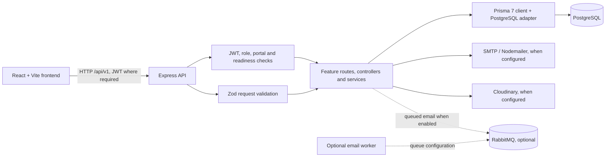

# TasteBridge

TasteBridge is a home-cooked food marketplace and community application. Customers discover dishes and cooks, place food orders, and book Home Dining experiences or workshops. Cooks manage their kitchen, menu, orders, experiences, and social content. Delivery agents handle eligible delivery work. Admins review accounts and content and manage marketplace operations.

This repository contains a React single-page application, an Express API, and a PostgreSQL database accessed through Prisma. It is a development repository; a successful local setup does not establish production readiness or verify third-party services.

## Project map

```text
TasteBridge/
├── README.md
├── frontend/
│   ├── src/api/            Axios clients and feature API wrappers
│   ├── src/components/     Shared and feature-specific React UI
│   ├── src/layouts/        Customer, Cook, Delivery Agent, and Admin shells
│   ├── src/pages/          Routes and portal pages
│   ├── src/routes/         Protected, role, and active-portal routing
│   ├── src/store/          Redux Toolkit store and slices
│   ├── src/utils/          Client-side formatting and workflow helpers
│   └── tests/              Node test-runner frontend tests
└── backend/
    ├── prisma/
    │   ├── schema.prisma   PostgreSQL schema and Prisma models
    │   ├── migrations/     Ordered SQL migration history
    │   └── seed.js         Local Admin, settings, and category seed
    ├── src/
    │   ├── modules/        Feature routes, controllers, services, validation
    │   ├── middlewares/    Authentication, authorization, validation, errors
    │   ├── services/       Shared SMTP, Cloudinary, and other services
    │   ├── config/         Environment and Prisma/PostgreSQL configuration
    │   ├── utils/          Shared backend validation and domain helpers
    │   └── tests/          Node tests, including PostgreSQL integration suites
    └── prisma7.config.ts   Prisma 7 schema, migration, and seed configuration
```

Backend feature code is grouped by module, generally with routes/controllers delegating to services. The API is mounted under `/api/v1`. The frontend uses React Router, Redux Toolkit, Axios, React Hook Form, and Zod. `DishStory` is recipe/heritage information attached to a dish; `CookStory` is a separate social-media story entity.

## Architecture



The backend's Prisma adapter uses the PostgreSQL driver pool. The frontend API client reads `VITE_API_BASE_URL`; protected requests use the application's authentication token. Backend CORS origins are configured with `CORS_ORIGINS`. Authentication and authorization are enforced by backend middleware and services; frontend route guards are not a security boundary on their own.

### Main data areas

The Prisma schema currently contains models for:

- Identity and eligibility: `User`, `PendingRegistration`, `CookProfile`, `DeliveryAgent`, `DeliveryAgentPayoutDetails`, `VerificationDocument`, `PasswordResetToken`.
- Marketplace: `FoodCategory`, `Dish`, `DishStory`, `Address`, `CustomerFavorite`, `Cart`, `CartItem`.
- Food ordering and payment records: `Checkout`, `CheckoutLine`, `CheckoutCookSnapshot`, `PaymentAttempt`, `PaymentAttemptEvent`, `Order`, `OrderItem`, `OrderStatusHistory`.
- Dine and Workshops: `Experience` (with an experience type), `ExperienceMenuItem`, `ExperienceSlot`, `ExperienceBooking`, `ExperiencePaymentAttempt`, `ExperiencePaymentEvent`, `ExperienceRefund`.
- Reviews and moderation: `Review`, `ReviewReport`, `ReviewModerationLog`.
- Social Stories and Posts: `CookStory`, `CookPost`, `CookPostMedia`, `CookPostLike`, `CookPostComment`, `SocialContentReport`, `SocialModerationAction`.
- Notifications and settings: `PlatformNotification`, `CookNotification`, `UserNotification`, `PlatformSettings`.

Foreign keys, unique constraints, and indexes are defined in `backend/prisma/schema.prisma`. Review the schema and service behavior before changing a relation or deletion policy.

## Feature inventory and verification status

Status labels describe the evidence available in this repository and the preceding verification reports, not production certification:

- **Implemented and automated-tested:** relevant code and focused automated tests exist; this does not mean every path was browser-tested.
- **Implemented, but not end-to-end verified:** code is present, but a real authenticated browser/provider journey has not been confirmed.
- **Partial:** some workflows or panels are intentionally limited, use placeholders, or lack a real external settlement/integration.
- **Not implemented:** no implementation was found for the described capability.

| Area | Implementation found | Status and limits |
|---|---|---|
| Customer accounts | Registration with email verification, login, password reset, profile and address management, protected customer routes | Implemented with backend/frontend tests. Real SMTP delivery and a fresh-laptop browser journey are not verified here. |
| Customer marketplace | Category and dish discovery, public cook pages, favorites, cart, checkout, order list/detail, reviews, and notifications | Implemented and covered by automated tests. A live external payment-provider transaction is not verified. |
| Food orders and delivery | Cook order handling, delivery-agent onboarding/verification, eligible work, delivery history/statuses, earnings views, and payout-detail review | Implemented in code. Actual payout settlement is not modeled; live location tracking and third-party dispatch are not established. Delivery pages should be checked individually because some route sections share a section component. |
| Cook portal | Cook application/readiness and Admin approval, dish management, orders, earnings, profile, Dine/Workshop management and bookings, reviews, notifications, and social-content management | Implemented with focused tests. Full real-account browser coverage and external media-provider connectivity remain unverified. |
| Admin portal | Customer/Cook/Delivery Agent management, verification, categories/dishes/orders/payments, Dine and Workshop review/bookings, reviews, notifications, settings, and social-content moderation | Implemented with route and service tests. Do not infer production authorization from the frontend alone; API checks are authoritative. |
| Home Dining and Workshops | Experience publishing/review, slots and capacity, bookings, payment-attempt state, cancellation requests/decisions, completion, and review flow | Implemented. Prior isolated PostgreSQL integration suites were reported passing, but complete Workshop media/browser flow and real payment/refund processing are not verified. |
| Social Stories and Posts | Cook publishing, public feed/detail, likes/comments/replies, reporting/moderation, and Cook comment management | Implemented in code with unit/API and previously reported Social PostgreSQL integration coverage. Real Cloudinary uploads and full browser behavior are not verified. |
| Social network features | Followers/following, direct messages, hashtags, social ranking | Not implemented; excluded from current product scope. |
| Email queue | Nodemailer SMTP service and optional RabbitMQ email worker/configuration | SMTP is required for real OTP/reset email delivery. `RABBITMQ_ENABLED` defaults off; queue connectivity is not verified. |
| Cloudinary media | Upload services and metadata persistence for supported dish, verification, and social media flows | Requires each developer's Cloudinary account/configuration. Credentials being present do not prove connectivity; no live upload was performed for this README. |
| Payments and refunds | Food checkout and Dine payment attempt states include simulated behavior; Dine cancellation can record a simulated refund | Simulation is not payment processing or a provider-confirmed refund. Food paid/mock checkout cancellation has explicit unsupported-refund cases. Do not use for real money. |

The source contains real route/service implementations for many workflows, but no single end-to-end run verifies every portal. The table deliberately distinguishes automated coverage from real browser and provider behavior.

## Routes and API organization

The main customer routes include `/`, `/explore`, `/dishes/:id`, `/cooks/:id`, `/workshops/:id`, `/stories`, `/cart`, `/checkout`, `/orders`, `/my-events`, `/my-events/dine`, `/my-events/workshops`, `/reviews`, `/addresses`, `/profile`, and `/favourites`.

Cook routes are under `/cook`, including `/cook/dishes`, `/cook/stories`, `/cook/orders`, `/cook/events`, `/cook/dine-bookings`, `/cook/workshop-bookings`, `/cook/earnings`, `/cook/reviews`, and `/cook/profile`. Delivery Agent routes are under `/delivery-agent`; Admin routes are under `/admin`. Consult `frontend/src/routes/AppRoutes.jsx` for the source of truth, since routes can evolve.

The Express application mounts feature modules under `/api/v1`, including authentication, Admin, categories/dishes, Cook, cart, addresses, orders/payments, delivery agents, reviews, notifications, social content, and events/experiences. See `backend/src/app.js` and each module's route file for actual endpoints. Health check: `GET /api/v1/health` reports database connectivity and whether SMTP settings are configured; “configured” is not a live provider delivery guarantee.

## Windows development setup

### Prerequisites

- Windows with PowerShell.
- Node.js and npm. The inspected developer environment used Node.js `22.20.0` and npm `10.9.3`; package manifests do not declare an enforced `engines` range. These observed versions are not a formal support guarantee.
- A local PostgreSQL server and a role permitted to create/use a dedicated development database. PostgreSQL `18.x` was used in the inspected environment; the repository does not pin a server version.
- Git.
- Optional: SMTP credentials for email/OTP flows and Cloudinary credentials for media upload flows.

Install Node/PostgreSQL through your organization's approved process. Never use a teammate's local database, the shared development database, or production credentials.

### Clone and install dependencies

Replace the URL with the team's GitHub clone URL. Run each `npm ci` in its package directory so the committed lockfile is used.

```powershell
cd D:\
git clone <team-repository-url> tastebridge
cd D:\tastebridge

cd backend
npm ci

cd ..\frontend
npm ci
```

### Create a local database

Use a local PostgreSQL administrator (for example, through `psql -U postgres` or pgAdmin). Create a developer-specific role and an empty, local database. In `psql`, the password prompt avoids placing the password in a SQL command:

```sql
CREATE ROLE tastebridge_dev LOGIN;
\password tastebridge_dev
CREATE DATABASE tastebridge OWNER tastebridge_dev;
```

Use your own role/database names if desired. Keep the database local and separate from any test database. In the backend `DATABASE_URL`, use the PostgreSQL URL form:

```text
postgresql://tastebridge_dev:<URL-ENCODED-PASSWORD>@localhost:5432/tastebridge?schema=public
```

URL-encode reserved characters in the password. Do not share or commit this URL. Confirm the database name and host before running a migration or seed.

### Configure private environment files

Create local files from the safe templates; these files are ignored by Git. Do not replace existing personal settings blindly.

```powershell
cd D:\tastebridge\backend
Copy-Item .env.example .env
notepad .env
```

Set at least:

- `DATABASE_URL` to the developer's own local database.
- `JWT_SECRET` to a long, unique random secret. One PowerShell option copies a generated 48-byte Base64URL value to the clipboard without echoing it in the terminal; paste it into the ignored backend `.env` and keep it private:

  ```powershell
  node -e "process.stdout.write(require('node:crypto').randomBytes(48).toString('base64url'))" | Set-Clipboard
  ```

- `SEED_ADMIN_EMAIL` and a unique strong `SEED_ADMIN_PASSWORD`. Use a password manager to generate/store the password; do not place it in a command line, chat, or source file.
- `PORT` and `CORS_ORIGINS` only if your local ports/origins differ from the defaults.

SMTP settings (`SMTP_HOST`, `SMTP_PORT`, `SMTP_SECURE`, `SMTP_USER`, `SMTP_PASSWORD`, `SMTP_FROM` / `EMAIL_FROM`) are needed to deliver real OTP and reset emails. `EMAIL_ENABLED` defaults on; missing SMTP credentials do not provide email delivery. RabbitMQ is optional and disabled unless `RABBITMQ_ENABLED=true`. Cloudinary settings (`CLOUDINARY_CLOUD_NAME`, `CLOUDINARY_API_KEY`, `CLOUDINARY_API_SECRET`) are required for actual uploads. Never copy another developer's credentials.

Configure the frontend separately:

```powershell
cd D:\tastebridge\frontend
Copy-Item .env.example .env
notepad .env
```

Set `VITE_API_BASE_URL=http://localhost:5000/api/v1` when using the default backend port. Frontend environment values prefixed `VITE_` are bundled for browser use; never put secrets in them.

### Generate Prisma Client, apply migrations, and seed

From `backend`, first inspect the `DATABASE_URL` target in `.env`. These explicit commands use the repository's `prisma7.config.ts`:

```powershell
cd D:\tastebridge\backend
npx prisma generate --config prisma7.config.ts
npx prisma migrate deploy --config prisma7.config.ts
```

`migrate deploy` applies checked-in migrations that are pending on the configured database. The repository currently has 34 ordered migration directories. **Fresh-database migration replay has not been verified as part of this README task.** If migration application fails, stop and inspect the target and migration error; do not use `prisma db push`, `migrate reset`, or manual SQL to bypass migration history.

For a new, private local development database, seed the initial Admin and defaults with:

```powershell
npx prisma db seed --config prisma7.config.ts
```

The seed requires non-empty `SEED_ADMIN_PASSWORD` and uses `SEED_ADMIN_EMAIL` (or its development default). It creates an Admin when absent and does not update an existing active Admin's account fields/password. It also upserts platform settings and the 13 regional categories, updating category descriptions/images to the seed definitions on rerun. Run it only on your own local database when those category updates are acceptable; do not treat it as a harmless read-only check or run it against shared/populated data without reviewing its effects.

To develop a schema change, work on a feature branch and a local development database. Create a migration with Prisma's migration-development workflow and the project config:

```powershell
npx prisma migrate dev --name <short_migration_name> --config prisma7.config.ts
```

Inspect the generated SQL and data impact, add/adjust tests, then verify the migration on an isolated disposable database before sharing it. Never edit an already-applied migration to change its meaning. Do not apply migrations to a shared/production database without an approved backup and deployment process.

### Start the applications

Run the backend and frontend in separate PowerShell terminals:

```powershell
# Terminal 1
cd D:\tastebridge\backend
npm run dev
```

```powershell
# Terminal 2
cd D:\tastebridge\frontend
npm run dev
```

Open the local Vite URL printed by the frontend command (normally `http://localhost:5173`). The backend defaults to port `5000`; API requests use `/api/v1`. If a port is occupied, choose a free port and update backend `PORT`, `CORS_ORIGINS`, and frontend `VITE_API_BASE_URL` consistently. Check `GET http://localhost:5000/api/v1/health` for database connectivity; SMTP status there reflects configuration presence only.

## Scripts and checks

### Frontend (`frontend/`)

| Command | Purpose |
|---|---|
| `npm run dev` | Start Vite development server. |
| `npm run build` | Create the production frontend bundle in generated build output. |
| `npm run preview` | Preview a production build locally. |
| `npm run lint` | Run ESLint over the frontend. |
| `node --test tests` | Run frontend tests; the package currently has no `npm test` script. |

### Backend (`backend/`)

| Command | Purpose / caution |
|---|---|
| `npm run dev` | Start the API with nodemon. Startup connects to PostgreSQL and may start configured background work. |
| `npm start` | Start the API with Node. |
| `npm test` | Run Node's test runner across backend tests. This includes PostgreSQL integration test files; do not run until test URLs are explicitly configured and verified to point to disposable test databases. |
| `npm run worker:email` | Start the email worker; requires the queue setup used by the environment. |
| `npx prisma generate --config prisma7.config.ts` | Generate Prisma Client. |
| `npx prisma validate --config prisma7.config.ts` | Validate schema/config locally. |
| `npx prisma migrate deploy --config prisma7.config.ts` | Apply pending repository migrations to the configured target. Writes schema state. |
| `npx prisma db seed --config prisma7.config.ts` | Run the seed described above; writes account/settings/category data. |
| `npx prisma studio --config prisma7.config.ts` | Open Prisma Studio for the configured database. Treat edits as database writes. |
| `npm run migrate:cloudinary` | Operational document migration script; not part of normal setup. Review its target and effects before use. |

Backend tests are in `backend/src/tests`. The Dine/Workshop integration test uses `DINE_TEST_DATABASE_URL`; the HTTP foundation integration tests also require `DATABASE_URL` to match the intended Dine test target. Social PostgreSQL integration uses `SOCIAL_TEST_DATABASE_URL`. These suites create and clean test fixtures. Use separate disposable databases, verify actual server/database identity and connection-routing parameters before running, and never point them to the development database named `tastebridge` or production. Do not assume a database is disposable from its name alone. There is no safe claim that the full backend test command is database-free.

For quick static checks, use the relevant package scripts and `node --check <path-to-file.js>` for a changed backend JavaScript file. Run `git diff --check` before submitting.

## External services and money flows

- **Payments:** source explicitly includes simulated checkout/Dine payment behavior. A simulated success is not a real charge, settlement, or provider-verified payment. Some paid food-order cancellations are rejected because refunds are unsupported. Dine refund records in simulation are not real refunds. No live payment-provider credentials or end-to-end gateway processing were verified here.
- **Razorpay/webhooks:** provider-related enums and webhook-signature utilities exist in source, but their existence does not prove a configured live gateway or successful live webhook integration. Verify provider onboarding, signature handling, idempotency, and reconciliation separately before enabling real payments.
- **Email/OTP:** Nodemailer sends verification and password-reset mail through configured SMTP. Configure your own SMTP account to test delivery. `EMAIL_ENABLED` is not a substitute for valid SMTP credentials.
- **RabbitMQ:** optional email queue support exists; disabled by default. Queue behavior/connectivity depends on local configuration and has not been verified here.
- **Cloudinary:** configured services upload public marketplace/social media and private verification documents. Each developer needs their own approved credentials. Do not claim an upload works until the provider connection and full persistence/display path have been tested.
- **Delivery payout:** the application stores UPI payout details and Admin review state. The Cook earnings service says settlement is not tracked; no delivery/cook payout transfer integration is established by this repository inspection.

## Team workflow

1. Pull the latest default branch and create a focused branch: `git switch -c feature/<short-name>`.
2. Keep personal configuration in ignored `.env` files; commit only safe `.env.example` templates. Never put credentials in `VITE_` variables, logs, screenshots, or test fixtures.
3. Make a small, scoped change. For database changes, add a new migration and tests; inspect the SQL and verify it against a disposable PostgreSQL database before opening a pull request.
4. Run focused tests and checks, then the relevant broader suites. Verify integration-test targets before running anything that writes.
5. Review `git status`, `git diff --check`, and the complete staged diff. Stage explicit paths rather than using `git add .` when the worktree contains unrelated files or diagnostics.
6. Push the feature branch and open a pull request. Describe schema changes, environment additions, migration order, test commands/results, and any external-service setup required.

### Before a push checklist

- [ ] No `.env`, credentials, database dumps, logs, generated bundles, or unrelated files are selected.
- [ ] Required source, assets, tests, configuration templates, and all intended ordered migrations are included.
- [ ] Migrations were inspected and tested on an isolated database; no development or production database was reset.
- [ ] Frontend/backend checks and relevant integration tests are reported accurately.
- [ ] New environment variables are documented in the example template and README without real values.
- [ ] Known external-integration and browser-verification gaps are stated.

## Known limitations and roadmap

### Incomplete product scope

- Social followers/following, direct messaging, hashtags, and ranking are not implemented.
- Some Delivery Agent route sections share a generic section page; inspect each before treating it as a complete independent workflow.
- Settlement of Cook or Delivery Agent earnings is not represented as a completed funds-transfer workflow.
- Food order refund support is limited; Dine simulated refund records must not be described as provider refunds.

### Not verified by repository presence or automated tests alone

- Replay of all 34 migrations against a brand-new teammate database (not verified in this documentation task).
- Browser testing of every portal and user journey on a clean laptop.
- Real SMTP delivery, RabbitMQ operation, Cloudinary upload/delete behavior, payment-provider transactions/webhooks, and payout settlement.
- Production deployment, monitoring, backup restoration, and production security configuration.

### Previously recorded checks (historical, not rerun for this README)

Prior verification reports recorded 251/251 frontend tests, 540/540 backend unit/mock tests, and 50/50 tests across three isolated PostgreSQL integration suites. A Prisma validation, `git diff --check`, and production build were also previously reported successful. These results predate this README edit and are not a fresh verification of the current uncommitted worktree. A prior audit reported 7 remaining frontend ESLint errors, all `react-hooks/set-state-in-effect`, in:

- `frontend/src/components/layout/Navbar.jsx`
- `frontend/src/layouts/CookLayout.jsx`
- `frontend/src/pages/cook/BecomeCookPage.jsx`
- `frontend/src/pages/cook/panel/DishFormModal.jsx`
- `frontend/src/pages/delivery/BecomeDeliveryAgentPage.jsx`

Re-run the relevant commands on the exact branch/revision you plan to share, and report the actual result rather than relying on this historical snapshot.

## Source of truth

This README describes the repository state inspected on 2026-10-20. Route definitions, environment templates, package scripts, Prisma schema, migration SQL, and service implementations are authoritative and may change. When documentation and code disagree, verify the code and update this README in the same change.

